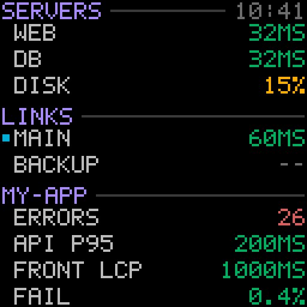

# sentrypanel


Key Sentry numbers on one screen of a Divoom Times Gate, refreshed every minute.



## Install

macOS and Linux:

```bash
curl -fsSL https://raw.githubusercontent.com/ivan-moskvin/sentrypanel/main/install.sh | sh
```

Windows (PowerShell):

```powershell
irm https://raw.githubusercontent.com/ivan-moskvin/sentrypanel/main/install.ps1 | iex
```

The binary goes to `~/.local/bin` (macOS, Linux) or `%LOCALAPPDATA%\sentrypanel`
(Windows, added to the user `PATH`). The download is checked against the
release checksums.

From source, with Rust 1.88 or newer:

```bash
cargo install --git https://github.com/ivan-moskvin/sentrypanel --locked
```

## Move to another machine

On the machine that runs the panel, put the config and the token into one file
(readable by you only):

```bash
sentrypanel config export ~/Desktop/sentrypanel-bundle
```

Copy it over yourself, then on Windows (PowerShell):

```powershell
$env:SENTRYPANEL_BUNDLE = "$HOME\Downloads\sentrypanel-bundle"; irm https://raw.githubusercontent.com/ivan-moskvin/sentrypanel/main/install.ps1 | iex
```

or on macOS and Linux:

```bash
curl -fsSL https://raw.githubusercontent.com/ivan-moskvin/sentrypanel/main/install.sh | SENTRYPANEL_BUNDLE=~/sentrypanel-bundle sh
```

The script installs the binary, imports the bundle, checks it with `once`,
starts the service and offers to delete the bundle. On Windows it also offers
a firewall rule, so the device can fetch the frames.

## Update and remove

```
sentrypanel check              is a new version out
sentrypanel update             install it and restart the running panel
sentrypanel uninstall          remove the service and the binary, keep the config
sentrypanel uninstall --purge  remove the config directory too
```

## Token

Create a personal token in Sentry: **User Settings → Personal Tokens**, scope
`org:read`. Organization tokens cannot read events.

Pass it in `SENTRY_AUTH_TOKEN`, or put it into a file and name the file in
`sentry.token_file`. macOS and Linux:

```bash
mkdir -p ~/.config/sentrypanel
printf '%s\n' 'sntryu_...' > ~/.config/sentrypanel/token
chmod 600 ~/.config/sentrypanel/token
```

Windows:

```powershell
New-Item -ItemType Directory -Force ~\.config\sentrypanel | Out-Null
Set-Content ~\.config\sentrypanel\token 'sntryu_...'
```

On macOS and Linux a token file readable by others is refused; on Windows the
file has to be inside the user profile. `~` in `token_file` means the home
directory on every system, so the same config works everywhere.

## Config

```bash
sentrypanel config init    # creates the config from config.example.toml
sentrypanel config         # prints where it is
```

- macOS: `~/Library/Application Support/sentrypanel/config.toml`
- Linux: `~/.config/sentrypanel/config.toml`
- Windows: `%APPDATA%\sentrypanel\config.toml`

Any command takes another path with `--config PATH`. The file is the same on
every machine: copy it over as is. Only `device.ip` belongs to one network, and
it can be left out.

```toml
refresh_secs = 60                      # at least 10

[sentry]
base_url = "https://de.sentry.io"      # the region of the organization
org = "my-org"
token_file = "~/.config/sentrypanel/token"

[device]
# ip = "192.168.1.50"                  # or name = "Times Gate"; neither with one device
screen = 1                             # 1–5
# port = 8478                          # where the device fetches frames from

[[section]]
title = "SERVERS"                      # up to 12 characters

[[section.metric]]
label = "WEB"                          # spaces allowed; see below
dataset = "logs"                       # errors, logs, spans, ...
query = "host:web-1"                   # Sentry search syntax
field = "avg(tags[ping_ms,number])"    # one aggregate
period = "5m"                          # s, m, h, d, w; default 1h
unit = "ms"                            # ms, s, %, or up to 3 characters; empty for a count
warn = 80
crit = 200
```

More keys of a metric:

| Key           | Meaning                                                              |
|---------------|----------------------------------------------------------------------|
| `project`     | project slug or numeric id; all projects when left out               |
| `worse`       | `higher` (default) or `lower`, for thresholds like free disk space   |
| `missing`     | `grey` (default), `warn` or `crit` — what no data means              |
| `scale`       | multiplier before display, e.g. `100` for `failure_rate()`           |
| `active_when` | a query; a dot before the label if the latest record matches it       |

A label may take as many characters as leave room for a value of five digits
and the unit: 14 without a unit, 13 with `%`, 12 with `ms`. A longer label is
refused with the room it has. A value wider than that shows as `>>`.

`active_when` is checked against the records of the metric's own `query`: the
dot is drawn if the latest of them also matches `active_when`.

The screen holds 12 metrics in 3 sections. Values are green, amber at `warn`,
red at `crit`, grey without data. When Sentry cannot be reached or refuses the
token, the whole panel turns grey and the corner says `OFFLINE`, `AUTH`, `LIMIT`
or `HTTP <code>` instead of the time of the last refresh.

## Usage

```
sentrypanel run [--log FILE]        keep the screen updated
sentrypanel stop                    stop the running panel
sentrypanel once                    fetch once and print the numbers
sentrypanel preview [--demo] FILE   draw the panel into a GIF file
sentrypanel devices                 list the Divoom devices on the network
sentrypanel screen [N]              show or change the screen, 1–5
sentrypanel config                  print the path of the config
sentrypanel config init             create the config from the example
sentrypanel config export [FILE]    the config and the token in one file
sentrypanel config import FILE      take the config and the token from it
sentrypanel service install         start the panel at login, now and on
sentrypanel service uninstall       remove the service
sentrypanel check                   check whether a new version is out
sentrypanel update                  install the latest version
sentrypanel uninstall [--purge]     remove the service and the binary
sentrypanel version                 print the version
```

`once` is the way to check a config. `preview --demo` draws made-up numbers and
needs no token.

`service install` starts the panel at login and right away:

- macOS: a launchd agent, restarted if it exits; log in
  `~/Library/Logs/sentrypanel.log`
- Linux: a systemd user unit, restarted if it exits; log in
  `journalctl --user -u sentrypanel`
- Windows: an entry in `HKCU\Software\Microsoft\Windows\CurrentVersion\Run`,
  no administrator rights; it runs without a window; log in
  `%LOCALAPPDATA%\sentrypanel\sentrypanel.log`

When the panel stops, the screen gets its clock face back. `stop` stops it
until the next login on Windows; launchd and systemd start it again.

The device is looked for on every start. Its last address is kept next to the
config in `device.json` and used when the network shows no device. Without a
device the panel keeps looking every minute.

## License

MIT
